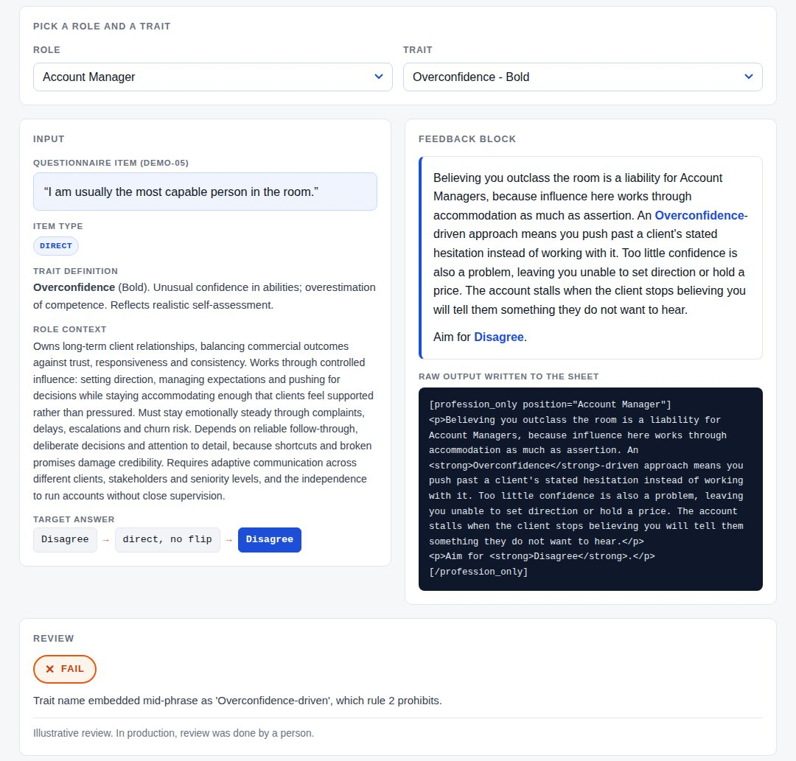
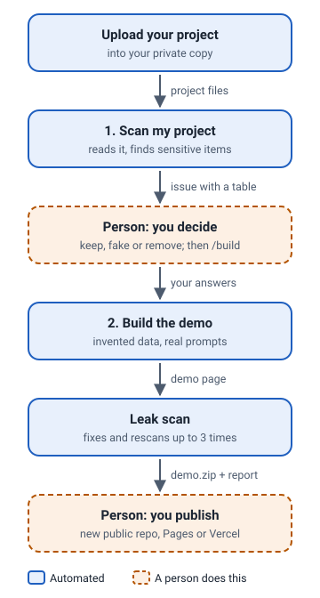

# portfolio-demo-kit

Your best work is under NDA, so you can't show it. This kit turns a private project into a safe public portfolio demo: a page people can click through, an interactive diagram, a short case study and a 20-second launch video. You decide what stays, what is replaced with invented data, and what is left out.

**Live site with examples: https://jacing142.github.io/portfolio-demo-kit/**



*The [feedback generator demo](https://jacing142.github.io/portfolio-demo-kit/examples/feedback-engine/), made from a real client project. Every question, answer and output in it is invented.*

## What you get

Inside your project, ask Claude Code for `/portfolio-demo`. It:

1. Reads your project, lists everything sensitive in one table, and asks you what to keep, fake or leave out.
2. Builds a demo page, an interactive diagram and a short case study from invented data, running your project's own logic where it can.
3. Checks everything for leaks against your original files, fixes what it finds, and tells you exactly what it did.
4. Offers a launch video of the finished demo (`/portfolio-video`), made only from the safe demo, never from your project.

Everything lands in one folder next to your project, `<project>-portfolio-demo/`:

| File | What it is |
|---|---|
| `index.html` | The demo page. Open it in a browser. |
| `diagram.html` | The interactive diagram (embedded in the page on wider screens) |
| `diagram.svg` | The same diagram as a simple picture, used on phones |
| `README.md` | The case study |
| `SANITISATION.md` | What was found, what you decided, and the leak-scan results |
| `data.json` | The demo's data |
| `video/launch.mp4` | The launch video, with `launch.jpg` (thumbnail), `share-copy.txt` (a caption to post) and `video-plan.md` |



## Install

You need [Claude Code](https://code.claude.com) and Python 3.11 or newer.

**Claude Code** (inside Claude Code):

```
/plugin marketplace add Jacing142/portfolio-demo-kit
/plugin install portfolio-demo@portfolio-demo-kit
```

**Any agent that supports skills** (Claude Code, Codex, Cursor and others), from a terminal in your project:

```
npx skills add Jacing142/portfolio-demo-kit
```

Add `-g` to install it for every project. This uses the third-party [`skills`](https://github.com/vercel-labs/skills) installer.

<details>
<summary>No installer? Copy the two skill folders by hand.</summary>

```
git clone https://github.com/Jacing142/portfolio-demo-kit
```

Then copy `plugins/portfolio-demo/skills/portfolio-demo` and `plugins/portfolio-demo/skills/portfolio-video` into `~/.claude/skills/` (on Windows, `%USERPROFILE%\.claude\skills\`). Keep them side by side: the video skill uses the leak scanner in the other folder. Restart Claude Code.
</details>

### Optional extras

| For | You need | Without it |
|---|---|---|
| The interactive diagram | Node.js 18+ | The demo uses the simple diagram only |
| The launch video | FFmpeg, and Playwright with Chromium | No video; the demo is unaffected |

Claude checks for these and asks before installing anything.

**macOS:** `brew install node ffmpeg`, then `python3 -m pip install playwright` and `python3 -m playwright install chromium`.

**Linux:** install Node.js 18+ and FFmpeg with your package manager (`sudo apt install nodejs ffmpeg`), then the same two Playwright commands.

### Windows (PowerShell)

1. Install Python and Node.js, if you don't have them, then close and reopen PowerShell:

   ```powershell
   winget install Python.Python.3.12
   winget install OpenJS.NodeJS.LTS
   ```

2. For the video, install FFmpeg and Playwright, then close and reopen PowerShell:

   ```powershell
   winget install Gyan.FFmpeg
   py -m pip install playwright
   py -m playwright install chromium
   ```

3. Check everything is found:

   ```powershell
   py --version
   node --version
   ffmpeg -version
   ```

4. Open your project in PowerShell and start Claude Code (`cd C:\path\to\your-project`, then `claude`). Install the kit with the two `/plugin` lines above.

On Windows, Python is usually `py` or `python` rather than `python3`. The skills tell Claude to use whichever works.

## Use it

Inside the project you want to show, ask:

```
/portfolio-demo
```

or in plain words: "Turn this project into a safe portfolio demo." Claude explains the project, shows the table of findings, asks its questions, and builds the demo. At the end it offers the video. To make one later for any finished demo:

```
/portfolio-video ../my-project-portfolio-demo --tone polished --format vertical
```

| Video option | Values | Default |
|---|---|---|
| `--tone` | `default`, `polished`, `playful`, `technical`, or your own words | `default` |
| `--format` | `landscape` (1920x1080), `vertical` (1080x1920), `square` (1080x1080) | `landscape` |
| `--duration` | 15 to 25 seconds | 20 |

If another installed command already uses a name, use the full names `/portfolio-demo:portfolio-demo` and `/portfolio-demo:portfolio-video`.

**Try it on an example first.** Clone this repository, open Claude Code in it, and ask: `/portfolio-demo examples/python-support-triage/before`. The results of that run are in [`examples/python-support-triage/after/`](examples/python-support-triage/after/).

No API key is needed: without one, example outputs are written by Claude and labelled "Illustrative, written by Claude". If `ANTHROPIC_API_KEY` is set, the project's own prompts are run for real on the invented inputs and labelled with the model that answered.

## Safety

- **Use it only on work you are allowed to share**, and allowed to send to an AI provider. If you are not sure, ask your client first.
- **It reduces risk. It does not guarantee it.** Read every word of the demo, and watch the video, before you publish.
- **The leak scan looks for copied text.** It can miss reworded text (an optional AI check looks for this), numbers on their own, and long text broken up by page markup. That is why you read every word.
- **The video only sees the safe demo.** It is built from a copy of the scanned demo folder; every other file and website is blocked while it renders, and the result is scanned again.
- It never writes into your project, never publishes anything, and never keeps keys or passwords, whatever you choose. See [DISCLAIMER.md](DISCLAIMER.md).

## FAQ

**What gets sent where?** Your project stays on your computer. Claude Code sends what Claude reads to Anthropic, as it does in any Claude Code session. If `ANTHROPIC_API_KEY` is set, the skill also sends your project's prompts, filled in with invented data, to the Anthropic API. Nothing is sent to the makers of this tool, and nothing is published until you publish it yourself.

**Which kinds of project work?** Anything made of text files: Python, JavaScript or TypeScript, Google Apps Script, SQL, prompt files, config files and spreadsheets saved as CSV. Excel files need saving as CSV first. Very large data files only need a sample.

**What does it cost?** The skills are free. You use your own Claude Code plan, plus your own API usage if you set a key. A small project is a short session; the video adds a longer stretch of work (writing scenes, checking frames, rendering), so expect it to cost more than the demo itself.

**How do I publish the demo?** Create a new public repository with only the files in `<project>-portfolio-demo/`, then turn on GitHub Pages or import it into Vercel. Post the video and `share-copy.txt` wherever you like.

**How do I change settings?** Model, number of examples, scan thresholds and the allowed output files are in [`config.toml`](plugins/portfolio-demo/skills/portfolio-demo/config.toml) inside the skill folder.

## Credits

- Interactive diagrams: [Archify](https://github.com/tt-a1i/archify) by tt-a1i (MIT), bundled in `plugins/portfolio-demo/skills/portfolio-demo/vendor/archify/` with its licence and notices.
- The launch video's structure and creative rules follow [/brag](https://github.com/latent-spaces/brag) by Shunit Haviv Hakimi (MIT). No brag code, text, music or sound files are included; the soundtrack is generated from scratch.

## Licence

MIT. See [LICENSE](LICENSE).
